# Architecture Overview

This document provides a high-level view of the NeuroTerminal system architecture and how the major components interact to translate natural-language intent into safe terminal execution.

```mermaid
flowchart LR
    U[User] --> I[Terminal Interface]
    I --> P[Natural Language Parser]
    P --> C[Intent Classifier]
    C --> D{Task Type}

    D -->|Simple automation| L[Local Execution Planner]
    D -->|Complex reasoning| A[AI Gateway]

    L --> V[Command Validator]
    A --> M[Model Providers\nOpenAI / Claude / Local LLM]
    M --> R[Response Synthesizer]
    R --> V

    V --> S[Security & Policy Layer]
    S --> E[Execution Engine]
    E --> OS[System / Shell / Network / Files]
    OS --> O[Results & Output]
    O --> K[Learning & Knowledge Store]
    K --> C

    E --> Lg[Audit Logs]
    V --> Lg
    S --> Lg

    classDef user fill:#f9f,stroke:#333,stroke-width:1px;
    classDef core fill:#dfefff,stroke:#333,stroke-width:1px;
    classDef ai fill:#e6ffe6,stroke:#333,stroke-width:1px;
    classDef safe fill:#fff4d6,stroke:#333,stroke-width:1px;
    classDef infra fill:#f0f0f0,stroke:#333,stroke-width:1px;

    class U user;
    class I,P,C,D,L,A,M,R,V,S,E,OS,O,K user;
    class A,M,R ai;
    class V,S,Lg safe;
    class E,OS infra;
```

## Component Responsibilities

- Terminal Interface: Accepts user commands, prompts, and context from the terminal.
- Natural Language Parser: Interprets commands and extracts goals, entities, and constraints.
- Intent Classifier: Routes tasks between local execution and AI-assisted reasoning.
- AI Gateway: Coordinates calls to cloud or local AI models for deeper analysis.
- Command Validator: Checks generated commands against safety, environment, and policy rules.
- Security & Policy Layer: Enforces permissions, risk assessment, and trust boundaries.
- Execution Engine: Runs approved commands and collects the results.
- Learning & Knowledge Store: Retains successful patterns and context for future optimization.
- Audit Logs: Tracks actions for review, debugging, and compliance.

## Design Notes

- The architecture is modular so that command execution can remain deterministic for simple tasks while delegating complex inference to AI models.
- Safety checks occur before execution to minimize risk from destructive or privileged operations.
- The learning layer continuously refines recommendations without bypassing user consent or policy enforcement.

